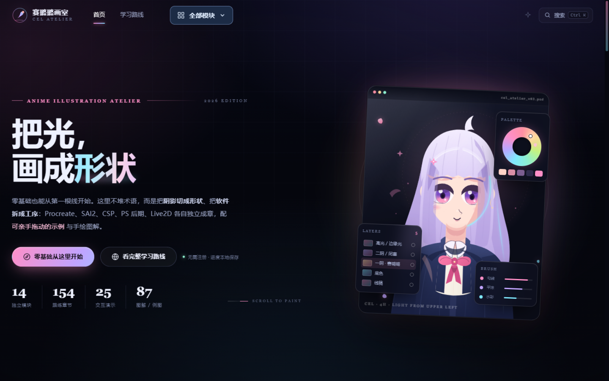

# 赛璐璐画室 · CEL ATELIER

围绕二次元插画与赛璐璐上色的静态学习站。课程覆盖 14 个模块、154 章，从造型基础到软件操作、Live2D、接稿沟通、职业边界与插画逆向工程。无需构建和后端。

## 界面截图

| 首页 | 赛璐璐专精模块 |
| --- | --- |
|  |  |

> 截图来自本地运行的静态站点，1440×900 视口。

## 当前内容

- 154 章均有本章概念补充、跟做步骤、常见错误、独立练习和验收要求。
- 154 个带答案解析的判断自测；答对不代表已经掌握绘画技能。
- 14 个完整微案例，涵盖线条、头像、手、透视、两色阶、光影、配色、上色流程、软件、Live2D、需求沟通与交易安全。
- 25 个交互演示及工具，不把判断自测或下载资源算入演示数量；包含插画元数据检查器。
- 53 组图解、11 组原例图，以及23组四格分镜，共92幅分镜。分镜说明使用可换行的 HTML 文字，并按章节显式绑定。
- 原创“月兔邮差”练习包：1200×1400 透明线稿、底色/一阴/收尾参考、透明效果层、分组 SVG、独立离线 HTML 手册。
- 16/18/20px 字号、纸色阅读、专注阅读、可展开术语、按章保存练习笔记。

## 开始使用

Windows 可双击 `start-server.bat`，然后打开 http://127.0.0.1:8788/ 。也可在项目目录运行：

```powershell
python -m http.server 8788 --bind 127.0.0.1
```

推荐通过本地服务器使用。直接打开 index.html 时，浏览器可能限制存储、导出等功能。

零基础建议先学“入门前夜”，再选造型地基与赛璐璐主线。软件模块只选自己正在用的一款，不必一次读完全部内容。可先在赛璐璐第 10 章下载线稿，分开练造型与上色。

## 模块地图

| 模块 | 章节 | 主要内容 |
| --- | ---: | --- |
| 入门前夜 | 9 | 工具、学习安排、参考、画布与练习方法 |
| 造型地基 | 13 | 线条、头部、五官、人体、手脚、衣褶、透视与明暗 |
| 赛璐璐专精 | 12 | 色阶、阴影、光源、闭塞、高光、材质、配色与完整流程 |
| iPad / Procreate | 9 | 画布、画笔、图层、手势、上色与导出 |
| SAI2 | 9 | 线稿、防抖、水彩、图层与完整流程 |
| Clip Studio Paint | 10 | 矢量、填充、网点、漫画、3D 与动画 |
| Photoshop | 11 | 图层、曲线、映射、蒙版、后期与导出 |
| Live2D | 11 | 分层补画、网格、变形器、参数、物理与交付 |
| 接稿与职业 | 11 | 需求、报价、授权、修改、付款、交付与合同 |
| 接稿安全 | 12 | 钓鱼、伪付款、陌生程序、账号与证据处理 |
| 逆向工程 | 14 | 软件与时间线索、元数据检查器、文件结构、水印、SVG与PSD重建边界 |
| R18 审阅 | 11 | 用非露骨情境学习年龄、同意、权利与平台边界 |
| 行业迷思 | 12 | 天赋、童子功、工具、素描、参考与学习误区 |
| 练习体系 | 10 | 起点测试、分项练习、复盘、作品与计划 |

## 阅读与操作

- `Ctrl/Cmd + K` 打开全文搜索，新增的跟练与完整案例也可搜到。
- `Esc` 关闭搜索、图片放大或移动目录。
- 章节顶部可切换字号、纸色与专注阅读，也可标记完成。
- 图解默认完整显示，可用“放大读字”开启局部横滑；响应式步骤图与页面正文自动换行。
- 练习记录和完成进度只保存在当前浏览器，不会跨设备同步；重要笔记请另行备份。
- 阅读分钟数按正文长度粗估，跟练、排错与复测另计。

## 插画元数据检查器

从“逆向工程”模块首页点击“打开实用检查器”，或进入第3章。选择/拖入一张 PNG、JPEG、WebP，读取现存软件、日期与作者等声明，保留来源和原值，支持图片预览、清空、复制和下载 TXT 报告。最大32 MiB；解析在本地 Worker 运行，图片不上传，不依赖运行时 CDN。解析依赖和教学样本已打包随页面载入，分析时不再通过 fetch/importScripts 读取额外文件；兼容直接打开 HTML 时的本地文件限制。文件读取、解析启动和超时分别提示。

真实绘制起止与工时不能单凭这些标签确定。lastModified 单独显示，不当作创作时间。扩展 XMP、私有字段等仍需 ExifTool 复核；具体范围和限制在工具内及报告中说明。解析依赖 exifr 7.1.3（MIT），许可保留在 `assets/js/vendor/`。

提取诊断会区分“未发现支持的附加信息块”“块已发现但解析不完整”和“成功读取其他字段但没有软件/日期”。支持 JPEG Photoshop APP13 中的 IPTC/XMP 与 COM 注释、XMP History 的 softwareAgent/when、PNG date:create/date:modify 等别名。主页面与 Worker 版本不一致会明确提示强制刷新，避免旧缓存结果被当作字段缺失。

缺少软件或日期时还会给出与提取结果分开的候选推测；可手动补充用途、设备和文件来源。候选不表示经过统计校准的概率，也不会补写进图片或提取字段。`tools/review/metadata-reference-comparison.json` 记录 ExifTool 13.63 对4个测试文件、14个字段的交叉读取结果。

开发检查：`node tools/test-reverse-metadata.cjs`、`node tools/test-metadata-runtime.cjs`。修改解析器、worker、依赖或教学 PNG 后运行 `node tools/build-metadata-runtime.cjs` 更新已提交的运行包；审计会检查运行包是否与源码一致。`tools/fixtures/metadata/` 中图形为原创测试素材，附加软件、作者和时间标签为虚构数据，不作为真实创作记录。

## 练习素材

下载入口位于赛璐璐第 10/12 章及练习第 5 章，也可直接使用 `assets/practice/cel-postal-practice.zip`。

手册 `assets/practice/postal-guide.html` 已内嵌四张阶段图，单独下载后可离线阅读。PNG 可导入常见绘画软件；SVG 是分组矢量源文件，不等同于 PSD，也不保证所有软件可直接打开。先完成底色和一阴，再尝试改光位。

## 维护与验证

课程正文在 `assets/js/content/`；六个 `tutors-*.js` 提供针对章节的补充，`worked-cases.js` 提供完整案例。`learning.js` 合并内容并挂载阅读、自测与记录；`learning-visuals.js` 提供新分镜，`reader.css` 负责阅读样式。

```powershell
node tools/audit-content.cjs
python tools/build_practice_kit.py
```

前者检查脚本语法、154 章数据与渲染、全部演示/图解引用及主要资源路径；后者重新生成原创练习包，需要 Python 与 Pillow。

2026-11-16 当前版本复核（资源版本 20261117）：

- 14 模块 / 154 章；逐章路由渲染 **154/154**，未检出 404、未加载、`undefined` 或对象字符串。
- 演示注册 194 个：154 个章节自测 + 25 个主演示/工具 + 14 个分步例图 + 1 个练习素材；演示/图解/例图引用完整性 **0 缺失**。
- 53 组图解 + 11 组原例图 + 23 组四格分镜（92 幅分镜）；章节绑定与总览正常。
- 实测：元数据检查器本地读取 PNG 并输出软件/日期字段与报告；阅读字号/纸色/专注切换、笔记刷新保存、搜索新增章节、练习包下载均可用；320/390/768/1024/1440 五个宽度 × 4 个代表页面无整页横向溢出。
- 本轮修复：首页统计在后台标签/低帧率下停留 0；首页仍写“十三个房间”而实际 14 模块；零基础主 CTA 从“赛璐璐”改为“零基础从这里开始”；末行模块卡片补跨列。
- 未做：真实零基础学习者的长期试学；所有软件版本未逐款实机复现。课程广度足够，但仍需用作品与反馈验证掌握程度。

2026-11-15 验收记录（140 章版本）：

- 全 140 章及首页、路线、图鉴、13 个模块页，在 320/390/768/1024/1440px 宽度、正文 20px 下共检查 780 个页面与尺寸组合。
- 未发现检查范围内的整页横向溢出、越界内容或隐藏容器中的末端文字裁切；传统图解的局部横滑属于设计行为。
- 图鉴中传统 SVG 的文字边界检查通过，引用完整性 0 缺失。
- 抽验纸色/专注/字号、术语、自测错选与改选、笔记刷新保存、章节完成保存、搜索新增案例、移动目录及 Esc 关闭、图片放大与练习包下载。
- 全站回归期间没有捕获到浏览器错误或警告。详细尺寸记录及桌面/手机截图在 `tools/review/`。

这些检查反映当前浏览器下的结果，尚未进行真实零基础学习者的长期试学。广度已经充足，核心课程也有更完整的跟练；Live2D 和职业模块仍属于入门到流程指导，不能替代实操反馈与专项深入训练。

2026-11-15 内容准确性复核（资源版本 v23）：

- 13模块、140章及关联图解/演示纳入检查；20章主体重写，并同步修订买书、年龄、参考版权、造型光影、软件功能、报价与定金等表述。
- 对Apple Pencil、Procreate色彩模型、CSP动画帧数和民法典定金规则等查阅官方原始资料；软件并未逐款逐版本实机复现。
- 28项已知事实错误回归检查通过；全站780组布局检查及末轮21组局部回归通过，十道迷思测验题意与解析复核通过。
- 详细前后对照、来源、证据与适用限制见 [内容准确性核查报告](tools/review/content-fact-audit.md)。全站检查不等于每个事实都有独立来源证明，也不保证固定时间学会或达到接稿水平。

同日排版修订（主样式 v24）：为全部模块首页补充响应式左右留白，避免标题图标、介绍卡片与章节列表紧贴目录分隔线；桌面保留32–48px内边距，手机页边距约20px。13模块在8个视口宽度下共104组检查，以及6组章节回归均通过，未检出整页横向溢出或所检文字裁切。记录与截图见 `tools/review/spacing-audit.json`、`spacing-desktop.jpg` 和 `spacing-mobile.jpg`。

同日图解字号修订（图解/应用脚本/阅读样式 v25）：5张文字密集的安全图解改为至少16px的响应式步骤卡片；其余44张传统图解默认采用清晰字号和局部横滑，并可切换全图预览。图注与分镜说明也已增大。全站780组布局回归，以及三档阅读字号、五种屏幕宽度的图鉴测量通过。详见 [图解可读性验收](tools/review/diagram-type-audit.md)。

同日分镜对应修订（应用/学习与分镜脚本 v26）：复核原83处章节分镜引用，移除27处主题覆盖不足的引用，3处更换专用分镜，其余53处保留。新增网暴处理、账号安全、网点3组分镜，重绘委托、防骗、审稿、复盘与绘画流程5组画面；共23组、92幅分镜，显式绑定56章。未知题材不再落入通用清单画面，审计会检查章节白名单、重复画面和关键错配回归。详见 [分镜对应核查](tools/review/story-relevance-audit.md)。

## 素材与规则

站内 SVG 与练习角色为原创教学示意，非软件截图或物理模拟。练习包允许个人学习、改色和带来源说明的练习展示；请勿冒充原画或把原素材单独出售。字体许可见 `assets/fonts/OFL.txt`。

软件界面、手势、价格、许可与平台规则可能变化，请按实际版本和官方现行说明核对。学习安排不保证固定时间内达到接稿水平，职业边界内容不替代法律意见。
